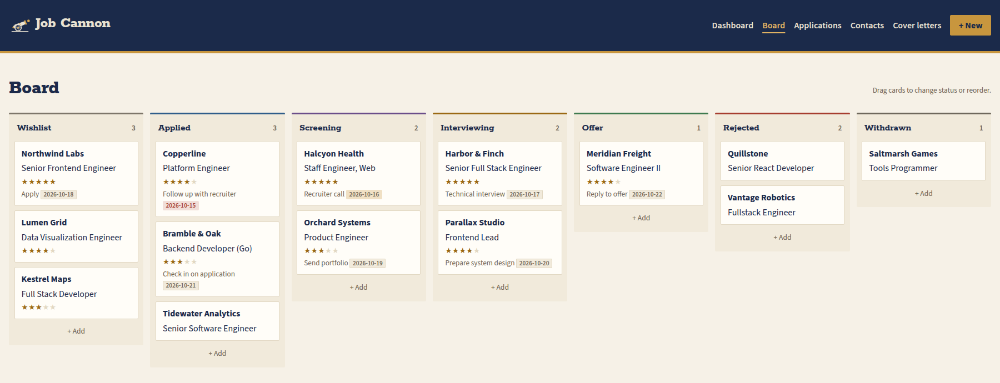

# Job Cannon

Most important thing first: the name is a reference to [this](https://www.youtube.com/watch?v=wbq571QME2Y&t=28s).

A local job-search manager: applications, a kanban board, contacts, interaction
log with follow-ups, and attached files (resumes, cover letters, postings).
Cover letters can start from named base letters with `{{placeholders}}`. Fill
them in on the application page (or have Claude Code do it with the
`tailor-cover-letter` skill), then attach the result as a PDF.

<picture>
  <source media="(prefers-color-scheme: dark)" srcset="docs/board-dark.png">
  
</picture>

The Claude Code skills (`find-jobs`, `tailor-cover-letter`) read your résumé
location from `.claude/job-search.local.md`; copy
`.claude/job-search.example.md` to get started.

It runs on your own machine and opens in your browser. **All of your data lives
in one folder**, so moving to another computer means copying that folder.

## Setup

Needs [uv](https://docs.astral.sh/uv/), which installs the right Python for you.

**Linux**
```sh
curl -LsSf https://astral.sh/uv/install.sh | sh
```

**macOS**
```sh
brew install uv          # or: curl -LsSf https://astral.sh/uv/install.sh | sh
```

Then, from this repo:
```sh
uv sync
uv run job-cannon        # opens http://127.0.0.1:8765/
```

Options: `--port 9000`, `--no-browser`, `--data-dir PATH`.

## Your data folder

Default location is `~/JobCannon` (override with `--data-dir` or the
`JOB_CANNON_DATA` environment variable).

```
~/JobCannon/
  jobcannon.db     # everything structured (SQLite)
  files/           # uploaded attachments
```

### Moving to a new computer

1. On the old machine, make a backup (safe to run while the app is open):
   ```sh
   uv run job-cannon backup --out ~/Desktop
   ```
   This writes `jobcannon-backup-YYYYMMDD-HHMMSS.zip`.
2. On the new machine, clone this repo, run `uv sync`, and unzip the backup
   into `~/JobCannon` (or anywhere, then point `--data-dir` at it).
3. `uv run job-cannon`.

Copying the whole `~/JobCannon` folder works too, as long as the app is stopped.

## Development

```sh
uv run pytest
```

- `src/job_cannon/repo/` — data access (plain `sqlite3`)
- `src/job_cannon/migrations/` — numbered SQL files, tracked with `PRAGMA user_version`;
  add the next `NNN_*.sql` for schema changes, and existing databases upgrade on next start
- `src/job_cannon/web/` — FastAPI routes; `templates/` Jinja + htmx; `static/` vendored
  Pico.css, htmx, and SortableJS (no build step, works offline)

## License

MIT. Vendored libraries and fonts keep their own licences (see the files in
`src/job_cannon/static/` and the `fonts/` folders).
